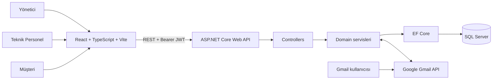
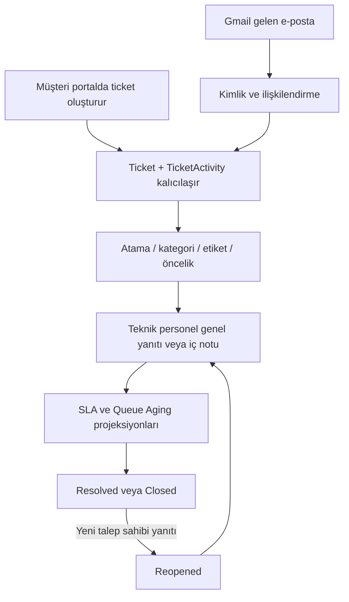

# Mimari

## Katmanlar

SupportFlow tek bir React web istemcisi ve ASP.NET Core REST API'den oluşur. API, controller katmanından servis katmanına ve Entity Framework Core üzerinden SQL Server'a ilerler. Frontend, JWT'yi istek başlığına ekleyen Axios istemcisi ile API'ye bağlanır.

## Backend Akışı

1. `Program.cs`, seçenekleri, DI kayıtlarını, JWT doğrulamayı, CORS ve Swagger'ı kurar.
2. Controller'lar HTTP, doğrulama ve authorization sınırıdır.
3. Servisler ticket, bildirim, sınıflandırma, SLA, Queue Aging, Gmail ve audit kurallarını uygular.
4. `AppDbContext`, EF Core modelini ve SQL Server şemasını temsil eder.
5. DTO'lar API sözleşmesini modellerden ayırır.

## Kesitsel Sistemler

### JWT ve yetkilendirme

JWT; issuer, audience, imza anahtarı ve ömür açısından doğrulanır. `OnTokenValidated` olayı token'daki kullanıcı ve rolün veritabanında halen etkin ve aynı rolde olduğunu kontrol eder. Böylece devre dışı bırakılmış kullanıcıların eski token'ları geçerli kalmaz.

### TicketActivity ve zaman çizelgesi

`TicketActivityWriter`, ticket değişikliğiyle aynı kayıt bağlamında kalıcı olay ekler. `TicketTimelineService`, bu yeni olayları eski mesaj ve durum geçmişi kayıtlarıyla kararlı sıralama/pagination içinde birleştirir. Customer görünümü yalnızca talep sahibine açık etkinlikleri içerir.

### SLA

`TicketSlaService` yaşam döngüsündeki başlangıç, ilk başarılı personel yanıtı, çözüm ve yeniden açma geçişlerini uygular. `TicketSlaCalculator`, API'ye ilk yanıt ve çözüm metriklerini, en acil SLA durumuyla yansıtır. Öncelik değişirse bitmemiş hedefler yeniden hesaplanır.

### Queue Aging ve iş yükü

`QueueAgingCalculator`, en son başarılı genel personel yanıtından sonra kalan talep sahibi etkinliğini bekleme çapası olarak kullanır. Çözülmüş ve kapalı ticket'lar bekleyen sayılmaz. SQL proje yolu ticket listesinde kullanılabilir; dashboard ve `AgentWorkloadService` aynı iş kurallarını API görünümlerinde sunar.

### Bildirimler ve sohbetler

`NotificationService`, kullanıcıya ait bildirimleri üretir ve okundu durumunu saklar. `ConversationService`, registered/external talep sahiplerini ayrı kimlik türleriyle gruplar; kullanıcıya özgü pin ve read-state kayıtlarını kullanır.

### Gmail

Gmail modülü OAuth yetkilendirmesi, okuma, ilişkilendirme, ek çözme ve Gmail REST API ile gönderim sorumluluklarını taşır. Web V1'de arka plan senkronizasyonu varsayılan olarak kapalıdır; Admin için manuel işleme mevcuttur. Ayrıntılar için [Gmail Entegrasyonu](GMAIL_INTEGRATION.md) belgesine bakın.

## Normal Ticket Akışı

## Dağıtım Sınırları

- Development CORS yalnızca yapılandırılmış `Frontend:DevelopmentOrigin` için açılır.
- Swagger yalnızca Development ortamında kaydedilir.
- SQL Server bağlantısı, JWT anahtarı ve Gmail OAuth kimlik bilgileri kaynak koduna konmamalıdır.
- Production CORS, secret yönetimi ve HTTPS/host ayarları dağıtım sorumluluğudur.
