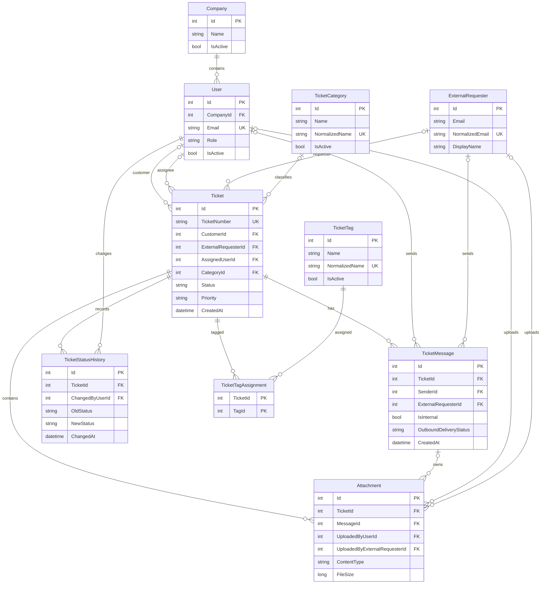
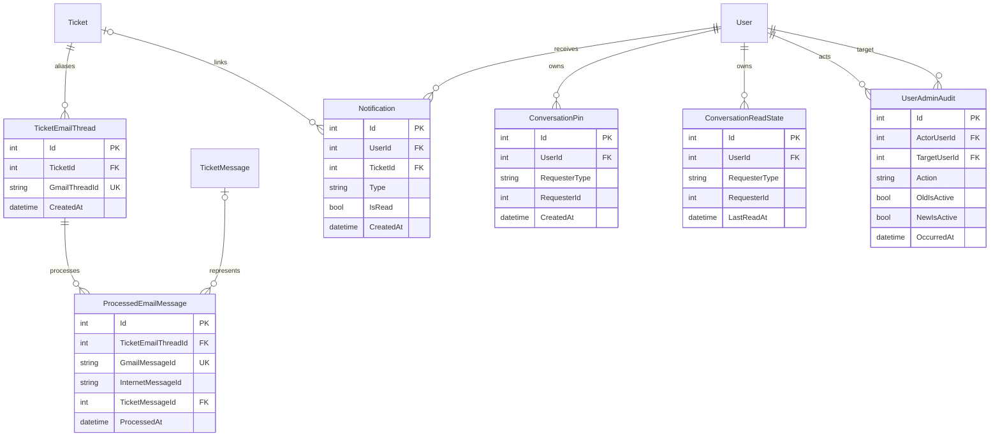
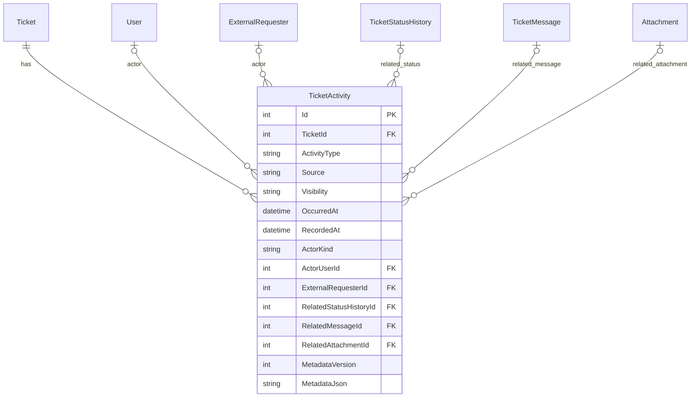

# Veritabanı ER Diyagramı

Bu diyagramlar `AppDbContext`, model sınıfları ve mevcut EF Core yapılandırmasından üretilmiştir. `ConversationPin` ve `ConversationReadState` talep sahibine polimorfik (`RequesterType`, `RequesterId`) bağlanır; bu nedenle doğrudan FK çizgisi yoktur.

## Çekirdek Ticket Modeli

## Gmail, Sohbet ve Audit Destek Modeli

## Etkinlik Modeli

## Önemli Kısıtlar

- `Users.Email`, `Tickets.TicketNumber`, `ExternalRequesters.NormalizedEmail`, `TicketCategories.NormalizedName`, `TicketTags.NormalizedName`, `TicketEmailThreads.GmailThreadId` ve `ProcessedEmailMessages.GmailMessageId` benzersizdir.
- `TicketTagAssignments` bileşik anahtarı `TicketId + TagId` kullanır.
- Pin/read-state için `UserId + RequesterType + RequesterId` benzersizdir.
- `TicketActivities` aktör türü ile FK alanlarının tutarlılığını denetleyen check constraint'lere sahiptir.
- İlişkilerde çoğunlukla `DeleteBehavior.NoAction` kullanılır; geçmiş verisi iş akışı dışı silinmez.
