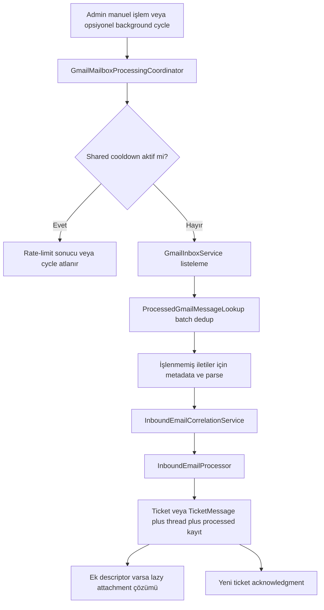

# Gmail Entegrasyonu

## Web V1 Yayın Politikası

**Otomatik Gmail senkronizasyonu varsayılan olarak kapalıdır. Manuel Admin işleme desteklenir.**

Hem `appsettings.json` hem `appsettings.Development.json` içinde:

```json
"GmailBackgroundSync": {
  "Enabled": false,
  "IntervalSeconds": 600,
  "InitialDelaySeconds": 30
}
```

Arka plan altyapısı mevcuttur; ancak sağlayıcı kota/rate-limit güvenliği nedeniyle Web V1 için otomatik çalışma varsayılanı kapalı tutulur. Admin, `/api/integrations/gmail/process` ile manuel fallback kullanabilir.

## OAuth ve İzinler

Gmail OAuth akışı `GmailAuthorizationService`, `GmailOAuthStateStore` ve `ProtectedFileDataStore` ile yönetilir. Kullanılan Gmail kapsamları yalnızca şunlardır:

- `https://www.googleapis.com/auth/gmail.readonly`
- `https://www.googleapis.com/auth/gmail.send`

OAuth durum, başlangıç ve callback endpoint'leri Admin yönetim alanındadır; callback Google yönlendirmesini alabilmek için anonime açıktır. Token içeriği API/dokümantasyon ile açığa çıkarılmaz.

## Gelen E-posta Akışı



`GmailMessageParser`, From/subject/thread/header ve attachment descriptor bilgilerini çıkarır. `InboundEmailProcessor`, önce kayıtlı Customer eşleşmesini arar; eşleşme yoksa `ExternalRequester` normalleştirilmiş e-posta üzerinden çözülür veya oluşturulur. Kendi mailbox'ından gelen iletiler inbound ticket olarak işlenmez.

## Correlation ve Deduplication

Gelen yanıtlar Gmail thread alias'ı, `In-Reply-To`, `References` ve konu içindeki ticket numarası sinyalleriyle mevcut ticket'a bağlanabilir. `TicketEmailThreads` Gmail `threadId` alias'larını saklar. `ProcessedEmailMessages.GmailMessageId` benzersizdir; aynı Gmail iletisi tekrar ticket, mesaj, ek veya acknowledgment üretmez.

Mailbox processor, liste sonucundaki mesaj kimliklerini önce `FindProcessedAsync` ile tek batch veritabanı sorgusunda kontrol eder. İşlenmiş ileti için tam Gmail mesaj okuması yapılmaz; böylece per-message N+1 okuma azaltılır.

## Attachment Davranışı

Gmail listesi/parse aşamasında ek descriptor'ları çıkarılır. Tam attachment içeriği yalnızca kalıcılık sonrası descriptor bulunuyorsa `ResolveAttachmentsAfterPersistenceAsync` ile alınır. İçe aktarılan ekler mevcut `AttachmentService` kontrollü depolama ve metadata akışını kullanır.

## Rate Limit, Cooldown ve Güvenli Yeniden Başlatma

`GmailApiRateLimitState` uygulama içinde shared singleton durumudur. Google `429 TooManyRequests` yanıtında sağlayıcının retry timestamp'i varsa onu kullanır; yoksa ardışık hata için sırasıyla şu fallback backoff'ları uygular:

```text
2 dakika -> 5 dakika -> 10 dakika -> 30 dakika
```

`GmailMailboxProcessingCoordinator` manuel ve background çağrılarını aynı cooldown üzerinden seri hale getirir. `GmailInboxBackgroundService`, cooldown aktifken cycle başlatmak yerine güvenli biçimde atlar. Başarılı Gmail çağrısı rate-limit sayacını temizler.

`GmailInboxDiscoveryState` in-memory'dir. API yeniden başladığında ilk background discovery sınırlı **bir günlük** catch-up sorgusu yapar. Sonraki başarılı cycle'lar önceki başlangıç gününden bir gün overlap içeren `after:YYYY/MM/DD` sorgusunu kullanır. Bu overlap, kalıcı Gmail message ID deduplication sayesinde güvenlidir.

## Diagnostics

`GET /api/integrations/gmail/diagnostics/messages` Admin-only ve read-only'dir. `GmailDiagnosticsCache` 90 saniyelik cache kullanır. Diagnostics, background worker tarafından çağrılmaz; inbox processing, ticket oluşturma, Gmail gönderme veya Gmail mesaj mutasyonu yapmaz.

## Operasyon Notu

Web V1 modunda Gmail sağlayıcı erişimi zorunlu değildir: portal, sohbet, SLA, Queue Aging ve kullanıcı yönetimi manuel Gmail processing olmadan çalışır. Gmail bir sağlayıcı cooldown'ına girerse Admin arayüzü retry zamanını gösterir; cooldown bitene kadar yeni Gmail çağrıları bastırılır.
