# Database ER Model

This document reflects the current EF Core model implemented in:

- `backend/SupportFlow.Api/Models/*`
- `backend/SupportFlow.Api/Data/AppDbContext.cs`

All explicitly configured foreign keys currently use `DeleteBehavior.NoAction`. There are no cascade delete rules configured in `AppDbContext`.

## Entity Summary

### Company

| Item | Details |
| --- | --- |
| Primary key | `Id` |
| Important fields | `Name`, `Email?`, `Phone?`, `IsActive`, `CreatedAt` |
| Foreign keys | None |
| Nullable relationships | None on the entity itself |
| Relationships | One `Company` to many `User` records |
| Indexes / constraints | `Name` max length 200 |
| Delete behavior | `User.CompanyId -> Company.Id` uses `NoAction` |

### User

| Item | Details |
| --- | --- |
| Primary key | `Id` |
| Important fields | `FirstName`, `LastName`, `Email`, `PasswordHash`, `Role`, `IsActive`, `CreatedAt`, `UpdatedAt?`, `CompanyId?` |
| Foreign keys | `CompanyId -> Company.Id` nullable |
| Nullable relationships | `CompanyId`, `Company` |
| Relationships | Many users may belong to one company; one user may create many tickets; one user may be assigned many tickets; one user may send many ticket messages; one user may upload many attachments; one user may receive many notifications; one user may create many ticket status history rows |
| Indexes / constraints | Unique index on `Email`; `Email` max 255; `FirstName`/`LastName` max 100; `Role` stored as string max 50 |
| Delete behavior | All related FKs to `User` use `NoAction` |

### Ticket

| Item | Details |
| --- | --- |
| Primary key | `Id` |
| Important fields | `TicketNumber`, `Title`, `Description`, `Status`, `Priority`, `CreatedAt`, `UpdatedAt`, `ClosedAt?`, `CustomerId`, `AssignedUserId?` |
| Foreign keys | `CustomerId -> User.Id` required; `AssignedUserId -> User.Id` nullable |
| Nullable relationships | `AssignedUserId`, `AssignedUser`, `ClosedAt` |
| Relationships | One customer can create many tickets; one technical staff user can be assigned many tickets; one ticket has many messages, history rows, attachments, notifications, and Gmail thread aliases |
| Indexes / constraints | Unique index on `TicketNumber`; `TicketNumber` max 30; `Title` max 250; `Status`/`Priority` stored as string max 50 |
| Delete behavior | `CustomerId` and `AssignedUserId` FKs use `NoAction` |

### TicketMessage

| Item | Details |
| --- | --- |
| Primary key | `Id` |
| Important fields | `TicketId`, `SenderId`, `Message`, `IsInternal`, `CreatedAt` |
| Foreign keys | `TicketId -> Ticket.Id` required; `SenderId -> User.Id` required |
| Nullable relationships | None |
| Relationships | Many messages belong to one ticket; many messages can be sent by one user; a message may optionally be referenced by attachments or processed Gmail rows |
| Indexes / constraints | No explicit unique index |
| Delete behavior | Both FKs use `NoAction` |

### TicketStatusHistory

| Item | Details |
| --- | --- |
| Primary key | `Id` |
| Important fields | `TicketId`, `ChangedByUserId`, `OldStatus`, `NewStatus`, `Note?`, `ChangedAt` |
| Foreign keys | `TicketId -> Ticket.Id` required; `ChangedByUserId -> User.Id` required |
| Nullable relationships | `Note` only |
| Relationships | Many history rows belong to one ticket; many history rows can be created by one user |
| Indexes / constraints | `OldStatus` and `NewStatus` stored as string max 50 |
| Delete behavior | Both FKs use `NoAction` |

### Attachment

| Item | Details |
| --- | --- |
| Primary key | `Id` |
| Important fields | `TicketId`, `MessageId?`, `UploadedByUserId`, `OriginalFileName`, `StoredFileName`, `FilePath`, `ContentType`, `FileSize`, `CreatedAt` |
| Foreign keys | `TicketId -> Ticket.Id` required; `MessageId -> TicketMessage.Id` nullable; `UploadedByUserId -> User.Id` required |
| Nullable relationships | `MessageId`, `Message` |
| Relationships | Many attachments belong to one ticket; many attachments may optionally belong to one ticket message; many attachments can be uploaded by one user |
| Indexes / constraints | No explicit unique index |
| Delete behavior | All three FKs use `NoAction` |

### Notification

| Item | Details |
| --- | --- |
| Primary key | `Id` |
| Important fields | `UserId`, `TicketId?`, `Title`, `Message`, `Type`, `IsRead`, `CreatedAt` |
| Foreign keys | `UserId -> User.Id` required; `TicketId -> Ticket.Id` nullable |
| Nullable relationships | `TicketId`, `Ticket` |
| Relationships | Many notifications belong to one user; many notifications may optionally reference one ticket |
| Indexes / constraints | `Type` stored as string max 50 |
| Delete behavior | Both FKs use `NoAction` |

### TicketEmailThread

| Item | Details |
| --- | --- |
| Primary key | `Id` |
| Important fields | `TicketId`, `GmailThreadId`, `CreatedAt` |
| Foreign keys | `TicketId -> Ticket.Id` required |
| Nullable relationships | None |
| Relationships | Many Gmail thread aliases can point to one ticket; one ticket email thread has many processed Gmail messages |
| Indexes / constraints | Unique index on `GmailThreadId`; non-unique index on `TicketId`; `GmailThreadId` max 255 |
| Delete behavior | `TicketId` FK uses `NoAction` |

### ProcessedEmailMessage

| Item | Details |
| --- | --- |
| Primary key | `Id` |
| Important fields | `TicketEmailThreadId`, `GmailMessageId`, `InternetMessageId?`, `TicketMessageId?`, `ProcessedAt` |
| Foreign keys | `TicketEmailThreadId -> TicketEmailThread.Id` required; `TicketMessageId -> TicketMessage.Id` nullable |
| Nullable relationships | `InternetMessageId`, `TicketMessageId`, `TicketMessage` |
| Relationships | Many processed Gmail messages belong to one Gmail thread alias; a processed Gmail row may optionally point to one created ticket message |
| Indexes / constraints | Unique index on `GmailMessageId`; non-unique indexes on `InternetMessageId` and `TicketEmailThreadId`; `GmailMessageId` max 255; `InternetMessageId` max 998 |
| Delete behavior | Both FKs use `NoAction` |

## Relationship Notes

- `User.CompanyId` is optional. Users can exist without a company.
- `Ticket.AssignedUserId` is optional. New tickets can remain unassigned.
- `Attachment.MessageId` is optional. The current attachment feature stores ticket-level attachments with `MessageId = null`.
- `Notification.TicketId` is optional. Some notifications can exist without a ticket context.
- `ProcessedEmailMessage.TicketMessageId` is optional. New inbound Gmail tickets are tracked with `TicketMessageId = null`, while correlated replies point to the created `TicketMessage`.

## Mermaid ER Diagram

```mermaid
erDiagram
    Company ||--o{ User : "optional membership"
    User ||--o{ Ticket : "creates as customer"
    User ||--o{ Ticket : "assigned staff"
    Ticket ||--o{ TicketMessage : "has messages"
    User ||--o{ TicketMessage : "sends"
    Ticket ||--o{ TicketStatusHistory : "has history"
    User ||--o{ TicketStatusHistory : "changes status"
    Ticket ||--o{ Attachment : "has attachments"
    TicketMessage ||--o{ Attachment : "optional message link"
    User ||--o{ Attachment : "uploads"
    User ||--o{ Notification : "receives"
    Ticket ||--o{ Notification : "optional context"
    Ticket ||--o{ TicketEmailThread : "gmail aliases"
    TicketEmailThread ||--o{ ProcessedEmailMessage : "processed messages"
    TicketMessage ||--o{ ProcessedEmailMessage : "optional reply link"

    Company {
        int Id PK
        string Name
        string Email
        string Phone
        bool IsActive
        datetime CreatedAt
    }

    User {
        int Id PK
        int CompanyId FK
        string FirstName
        string LastName
        string Email UK
        string PasswordHash
        string Role
        bool IsActive
        datetime CreatedAt
        datetime UpdatedAt
    }

    Ticket {
        int Id PK
        string TicketNumber UK
        int CustomerId FK
        int AssignedUserId FK
        string Title
        string Description
        string Status
        string Priority
        datetime CreatedAt
        datetime UpdatedAt
        datetime ClosedAt
    }

    TicketMessage {
        int Id PK
        int TicketId FK
        int SenderId FK
        string Message
        bool IsInternal
        datetime CreatedAt
    }

    TicketStatusHistory {
        int Id PK
        int TicketId FK
        int ChangedByUserId FK
        string OldStatus
        string NewStatus
        string Note
        datetime ChangedAt
    }

    Attachment {
        int Id PK
        int TicketId FK
        int MessageId FK
        int UploadedByUserId FK
        string OriginalFileName
        string StoredFileName
        string FilePath
        string ContentType
        long FileSize
        datetime CreatedAt
    }

    Notification {
        int Id PK
        int UserId FK
        int TicketId FK
        string Title
        string Message
        string Type
        bool IsRead
        datetime CreatedAt
    }

    TicketEmailThread {
        int Id PK
        int TicketId FK
        string GmailThreadId UK
        datetime CreatedAt
    }

    ProcessedEmailMessage {
        int Id PK
        int TicketEmailThreadId FK
        string GmailMessageId UK
        string InternetMessageId
        int TicketMessageId FK
        datetime ProcessedAt
    }
```

