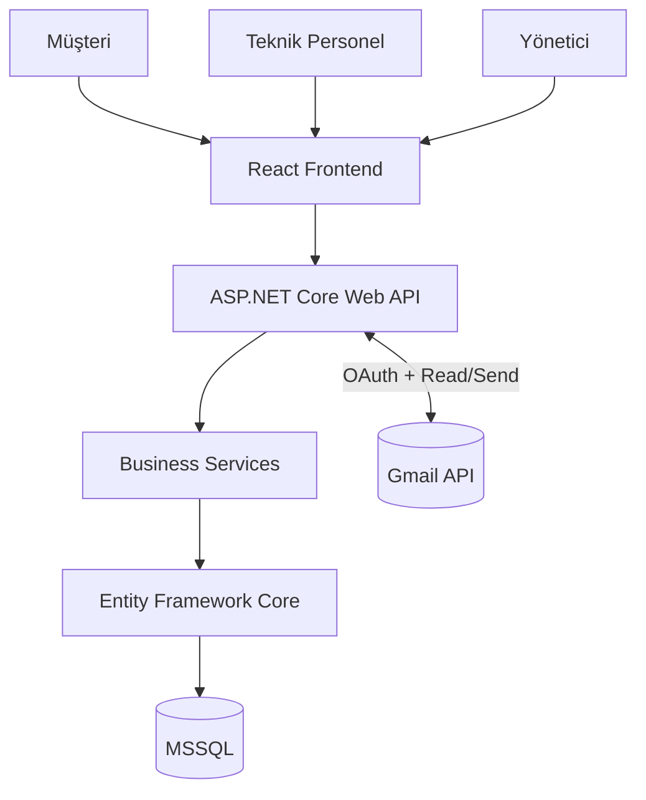
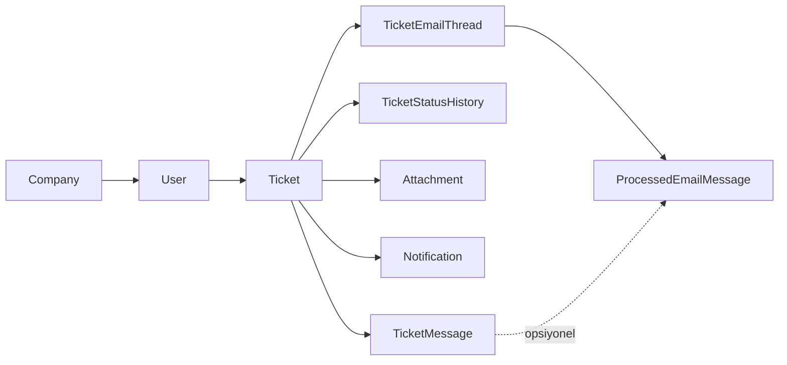
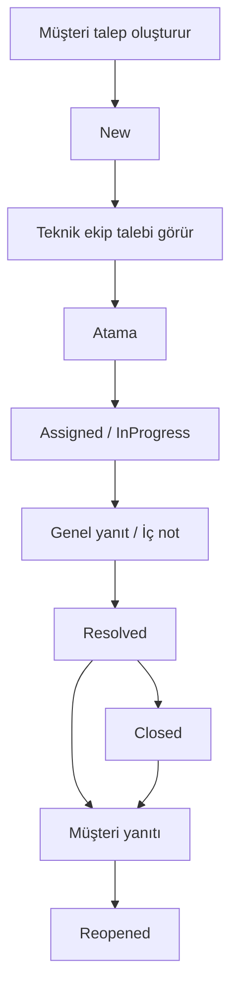

# SupportFlow Sunum Taslağı

Bu taslak, SupportFlow'un mevcut gerçek implementasyonuna ve D1 dokümantasyonuna göre hazırlanmıştır. Amaç, bilgisayar mühendisliği staj/proje sunumu için teknik olarak doğru ama sunum dostu bir akış oluşturmaktır.

Toplam ana slayt sayısı: `10`

## SLIDE 1 — SupportFlow

**Başlık**

SupportFlow Teknik Destek ve Talep Yönetim Sistemi

**Slaytta Görünecek İçerik**

- Web tabanlı teknik destek ve talep yönetim sistemi
- Staj kapsamında uçtan uca full-stack geliştirme projesi
- Amaç: müşteri taleplerini merkezi, izlenebilir ve güvenli biçimde yönetmek

**Tasarım Notu**

- Çok sade tutulmalı
- Ortada logo + başlık
- Altta tek cümlelik açıklama

**Sunumda Söylenecekler**

Bu projede SupportFlow adını verdiğim bir teknik destek ve talep yönetim sistemi geliştirdim. Proje, staj sürecinde hem frontend hem backend hem de veritabanı tarafını kapsayan gerçek bir full-stack çalışma olarak ilerledi. Temel hedefim, müşteri taleplerini dağınık iletişim kanallarından çıkarıp tek bir merkezde toplamak, bu talepleri takip edilebilir hale getirmek ve teknik ekip ile müşteri arasındaki iletişimi kayıt altına almaktı. Ayrıca projeye Gmail entegrasyonu ekleyerek e-posta üzerinden gelen destek taleplerinin de sisteme otomatik alınmasını sağladım.

---

## SLIDE 2 — Problem ve Projenin Amacı

**Slaytta Görünecek İçerik**

**Problem**

- Talepler farklı kanallardan geliyor
- İletişim geçmişi dağılabiliyor
- Atama ve durum takibi zorlaşıyor
- E-posta ile gelen destek kayıtları manuel yönetiliyor

**Çözüm**

- Tek merkezden talep takibi
- Rol bazlı iş akışı
- Durum ve geçmiş kaydı
- Gmail entegrasyonu ile otomatik kayıt oluşturma

**Sunumda Söylenecekler**

Gerçek hayatta destek süreçlerinde en büyük sorunlardan biri, müşteri iletişiminin dağınık olmasıdır. Bir talep telefonla, bir başkası e-postayla, bir diğeri web arayüzüyle gelebiliyor. Bu durumda geçmiş konuşmalar kaybolabiliyor, hangi talebin hangi aşamada olduğu net takip edilemiyor ve teknik ekibin iş yükü kontrolü zorlaşıyor. SupportFlow bu problemi merkezi bir yapı ile çözüyor. Müşteri talepleri tek sistemde tutuluyor, durumları yönetiliyor, atama yapılabiliyor, iç not ile dış yanıt ayrıştırılıyor ve e-posta üzerinden gelen talepler de otomatik olarak sisteme dahil ediliyor.

---

## SLIDE 3 — Kullanılan Teknolojiler

**Slaytta Görünecek İçerik**

**Frontend**

- React
- TypeScript
- Vite
- Material UI
- Axios

**Backend**

- ASP.NET Core Web API
- C#
- Entity Framework Core
- JWT Authentication

**Database**

- Microsoft SQL Server

**Integration**

- Gmail API
- Google OAuth 2.0

**Architecture**

- RESTful mimari

**Sunumda Söylenecekler**

Projede kullandığım teknoloji seçimini, hem öğrenme hedefi hem de kurumsal projelere yakınlık açısından yaptım. Arayüz tarafında React ve TypeScript kullandım; bu sayede bileşen tabanlı ve tip güvenli bir frontend elde ettim. Backend tarafında ASP.NET Core Web API ve C# kullandım. Veritabanı erişimini Entity Framework Core ile yönettim, verileri Microsoft SQL Server üzerinde tuttum. Kimlik doğrulama için JWT kullandım. En dikkat çekici teknik parçalardan biri de Gmail API ve Google OAuth 2.0 entegrasyonu oldu. Böylece sistem sadece web formundan değil, e-postadan da destek talebi alabilen bir yapıya dönüştü.

---

## SLIDE 4 — Sistem Mimarisi

**Slaytta Görünecek İçerik**



**Alt Açıklama**

- Frontend ve backend ayrı katmanlar olarak çalışır
- İletişim REST API üzerinden yapılır
- İş kuralları service katmanında tutulur
- Veritabanı erişimi EF Core ile yönetilir
- Gmail entegrasyonu backend üzerinden güvenli şekilde yürür

**Sunumda Söylenecekler**

SupportFlow’da katmanlı bir mimari tercih ettim. Kullanıcılar React tabanlı frontend üzerinden sisteme erişiyor. Frontend, tüm verileri doğrudan veritabanından değil, REST API üzerinden ASP.NET Core backend’inden alıyor. Böylece istemci ile iş kuralları ayrılmış oluyor. Backend tarafında controller’lar istekleri alıyor, asıl iş mantığı service katmanında yürütülüyor ve veri erişimi EF Core üzerinden SQL Server’a yapılıyor. Gmail entegrasyonu da yine backend üzerinde konumlandırıldı. Bunun sebebi OAuth, token yönetimi ve gelen e-postaların işlenmesi gibi güvenlik hassasiyetli süreçleri sunucu tarafında kontrol altında tutmak istememdi.

---

## SLIDE 5 — Veritabanı Tasarımı

**Slaytta Görünecek İçerik**

**Öne Çıkan Varlıklar**

- User
- Company
- Ticket
- TicketMessage
- TicketStatusHistory
- Attachment
- Notification
- TicketEmailThread
- ProcessedEmailMessage



**Vurgulanacak İlişkiler**

- Bir müşteri birden fazla ticket oluşturabilir
- Bir ticket’ın mesajları, durum geçmişi ve ek dosyaları vardır
- Bildirimler kullanıcı bazlıdır
- Gmail entegrasyonu için ayrı izleme tabloları kullanılır
- Şema evrimi EF Core migrations ile yönetilir

**Sunumda Söylenecekler**

Veritabanı tasarımında temel merkeze Ticket tablosunu yerleştirdim. Çünkü sistemin ana iş nesnesi destek talebidir. Her ticket bir müşteriye bağlıdır; buna ek olarak ticket mesajları, durum geçmişi, ek dosyalar ve bildirimler bu yapı etrafında şekillenir. Gmail tarafında ise e-posta akışını güvenilir şekilde izleyebilmek için `TicketEmailThread` ve `ProcessedEmailMessage` tablolarını ekledim. Böylece aynı e-posta tekrar işlenmez, cevaplar doğru ticket’a bağlanır ve Gmail thread bilgisi korunur. Şema değişikliklerini de Entity Framework Core migrations ile yönetilen bir yapı üzerinde tuttum.

---

## SLIDE 6 — Rol Bazlı Yetkilendirme

**Slaytta Görünecek İçerik**

**Customer**

- Talep oluşturma
- Kendi taleplerini görme
- Yanıt verme
- Ek dosya yükleme
- Bildirim ve profil işlemleri

**TechnicalStaff**

- Tüm talepleri görme
- Talep atama
- Genel yanıt verme
- İç not ekleme
- Durum güncelleme

**Admin**

- Teknik personel yetkileri
- Operasyon görünürlüğü
- Gmail entegrasyonu ve işleme ekranı

**Kısa Not**

- Yetkilendirme frontend’de değil, backend’de otoritatif olarak uygulanır

**Sunumda Söylenecekler**

Sistemde üç temel rol bulunuyor: Customer, TechnicalStaff ve Admin. Customer sadece kendi ticket’larını görüp yanıt verebiliyor. TechnicalStaff operasyonel ticket ekranlarını kullanabiliyor, atama yapabiliyor, durum güncelleyebiliyor ve müşteri tarafından görünmeyen iç notlar ekleyebiliyor. Admin ise bunlara ek olarak Gmail entegrasyonu ekranına ve ilgili işlemlere erişebiliyor. Buradaki önemli nokta şu: yetki kontrolü sadece arayüz seviyesinde yapılmıyor. Asıl otorite backend. Yani kullanıcı arayüzünde bir ekran gizli olsa bile, API tarafında rol ve kullanıcı doğrulaması yapılmadan işlem tamamlanmıyor.

---

## SLIDE 7 — Talep Yönetim Süreci

**Slaytta Görünecek İçerik**



**Ek Vurgular**

- Durum geçmişi kayıt altındadır
- Bildirimler süreç boyunca üretilir
- Ek dosyalar ticket üzerinde saklanır

**Sunumda Söylenecekler**

Ticket yaşam döngüsü müşteri tarafında talep oluşturulmasıyla başlıyor ve ilk durum `New` olarak sisteme kaydediliyor. Daha sonra teknik ekip bu talebi görüyor, gerekirse bir personele atıyor ve süreç `Assigned` veya `InProgress` aşamasına geçiyor. Teknik ekip hem müşteriye açık yanıtlar gönderebiliyor hem de sadece ekip içinde görünen iç notlar ekleyebiliyor. Çözüm tamamlandığında talep `Resolved`, ardından gerekirse `Closed` durumuna alınabiliyor. Projede özellikle önemli gördüğüm bir davranış da şu oldu: eğer müşteri çözülmüş ya da kapatılmış bir ticket’a tekrar yanıt verirse sistem bunu yeni ticket olarak açmak yerine otomatik olarak `Reopened` durumuna geçiriyor.

---

## SLIDE 8 — Gmail Entegrasyonu

**Slaytta Görünecek İçerik**

```mermaid
flowchart LR
    M[Customer Email] --> S[support11flow@gmail.com]
    S --> G[Gmail API]
    G --> SF[SupportFlow]
    SF --> T[Ticket]
    SF --> ACK[Acknowledgment Email]
    ACK --> C[Müşteri]
```

**Kısa Teknik Maddeler**

- OAuth 2.0 ile yetkilendirme
- `gmail.readonly` ve `gmail.send` scope’ları
- Gelen e-postadan otomatik ticket oluşturma
- Gönderen müşteri eşleştirme
- Otomatik acknowledgment e-postası
- Reply correlation
- Deduplication
- Self-message protection
- Gerekirse otomatik `Reopened`

**Sunumda Söylenecekler**

Bu slayt projenin en ayırt edici teknik parçasını gösteriyor. Sistem, Gmail API ile entegre çalışıyor. Yetkilendirme Google OAuth 2.0 üzerinden yapılıyor ve sadece gerekli iki scope isteniyor: biri mail okumak, diğeri mail göndermek için. Destek mailbox’ına gelen yeni bir müşteri e-postası işlendiğinde sistem önce göndereni aktif bir müşteri hesabıyla eşleştiriyor. Eğer eşleşme varsa ticket oluşturuyor, Gmail thread bilgisini saklıyor ve kayıt başarıyla commit edildikten sonra müşteriye otomatik bir acknowledgment e-postası gönderiyor. Daha sonra müşteri bu e-postaya yanıt verdiğinde sistem mesajı tekrar yeni ticket’a çevirmiyor; thread, header ve subject üzerinden korelasyon yaparak mevcut ticket’a bağlıyor.

---

## SLIDE 9 — Uygulama Arayüzü ve Gerçek Özellikler

**Slaytta Görünecek İçerik**

Bu slayt mümkün olduğunca ekran görüntüsü ağırlıklı olmalı.

**En Güçlü 4 Görsel Önerisi**

1. Login ekranı
2. Customer ticket detay ekranı, ek dosya görünümü ile
3. Technical/Admin ticket yönetim ekranı
4. Admin Gmail entegrasyonu ekranı

**İkinci Seviye Alternatifler**

- Customer dashboard
- Bildirimler ekranı
- Profil ekranı

**Kısa Not**

- Gerçek çalışan uygulamadan ekran görüntüsü kullanılmalı
- Kod görüntüsü veya sahte mockup kullanılmamalı

**Sunumda Söylenecekler**

Bu slaytta teknik mimariden çok uygulamanın gerçekten çalıştığını göstermek önemli. Özellikle giriş ekranı, müşteri tarafındaki ticket detay sayfası, teknik ekip ya da admin tarafındaki operasyon ekranı ve Gmail entegrasyonu ekranı birlikte gösterildiğinde sistemin uçtan uca olgunluğu net şekilde anlaşılır. Ben bu bölümde sadece güzel görünen ekranları değil, işlevi temsil eden ekranları göstermeyi tercih ederim. Örneğin attachment listesinin gerçekten göründüğü bir ticket detayı, bildirimlerin çalıştığını gösteren bir ekran ya da Gmail entegrasyonunda OAuth durumunun göründüğü bir admin sayfası, projeyi daha ikna edici hale getirir.

---

## SLIDE 10 — Sonuç ve Kazanımlar

**Slaytta Görünecek İçerik**

- Full-stack web geliştirme deneyimi
- REST API tasarımı
- Rol bazlı yetkilendirme
- MSSQL + EF Core kullanımı
- Gmail API / OAuth entegrasyonu
- Dosya yükleme ve güvenlik kontrolleri
- Bildirim yapısı
- Gerçek destek iş akışı
- Test ve güvenlik odaklı geliştirme

**Kapanış Cümlesi**

“SupportFlow, müşteri taleplerinin merkezi, izlenebilir ve güvenli bir şekilde yönetilebildiği uçtan uca bir teknik destek sistemi olarak geliştirilmiştir.”

**Sunumda Söylenecekler**

Bu proje bana sadece bir web arayüzü geliştirmeyi değil, uçtan uca ürün düşünmeyi öğretti. Frontend, backend, veritabanı, yetkilendirme, dosya yükleme, bildirim, entegrasyon ve test gibi birden fazla alanı birlikte ele alma fırsatı buldum. Özellikle Gmail entegrasyonu ve cevap korelasyonu gibi parçalar, projenin gerçek hayattaki destek süreçlerine yaklaşmasını sağladı. Teknik olarak baktığımda bu çalışma, REST mimarisi, katmanlı yapı, JWT tabanlı güvenlik, EF Core ve dış servis entegrasyonu gibi konularda güçlü bir uygulama pratiği sundu. Sonuç olarak SupportFlow, fonksiyonel ve gösterilebilir bir staj projesine dönüştü.

---

## Sunum Tasarım Önerileri

- Açık arka plan, mor vurgu rengi
- SupportFlow logosu sabit marka öğesi olarak kullanılmalı
- Slayt başına 3 ila 6 maddeyi aşmamaya çalışın
- Diyagramları slayta sığacak kadar sade tutun
- Kod ekran görüntüsü kullanmayın
- Mümkünse ekran görüntülerinde tarayıcı üst çubuğunu minimal bırakın

## Sunucuya Dayalı Doğruluk Notu

Bu taslak yalnızca gerçek implementasyonda bulunan özellikleri içerir:

- web tabanlı ticket yönetimi
- rol bazlı yetkilendirme
- ek dosya yükleme/görüntüleme
- bildirimler
- Gmail OAuth
- Gmail inbox işleme
- acknowledgment gönderimi
- reply correlation
- deduplication
- otomatik reopen davranışı

Bu taslakta, implementasyonda olmayan ek modüller veya yönetim panelleri tamamlanmış özellik gibi gösterilmemiştir.
