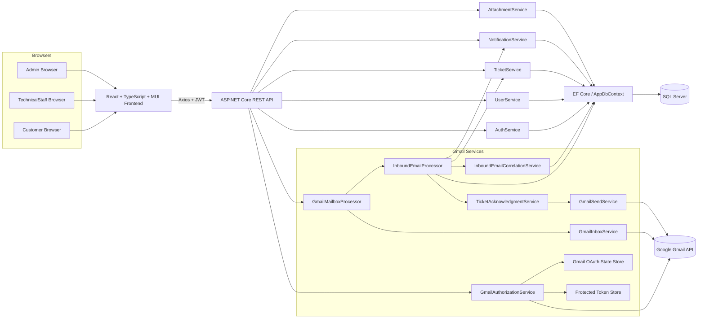

# System Architecture

This document reflects the current SupportFlow runtime structure implemented in the backend and frontend codebase.

## High-Level Stack

- Frontend: React + TypeScript + Vite + Material UI + Axios
- API: ASP.NET Core Web API with JWT authentication and role-based authorization
- Application layer: Controllers delegating to focused services
- Data access: EF Core with SQL Server
- External integration: Gmail API for OAuth, mailbox reads, and outbound acknowledgment sends

## Runtime Shape

1. Customer, TechnicalStaff, and Admin users work through the React frontend.
2. The frontend calls the REST API with Axios and a JWT bearer token.
3. ASP.NET Core validates the token, user identity, active status, and role on every authorized request.
4. Controllers delegate to services such as `AuthService`, `TicketService`, `UserService`, `NotificationService`, `AttachmentService`, and the Gmail services.
5. Services persist and query data through `AppDbContext` and EF Core against SQL Server.
6. Gmail flows call Google APIs through the Gmail integration services.

## Key Backend Components

### Authentication and RBAC

- JWT bearer authentication is configured in `Program.cs`.
- Token validation checks issuer, audience, signing key, lifetime, and current user state in the database.
- Authorization is role-based:
  - `Customer`
  - `TechnicalStaff`
  - `Admin`

### Ticketing

- `TicketsController` exposes ticket CRUD-like workflow endpoints.
- `TicketService` owns ticket creation, message creation, assignment, status changes, reopen behavior, and related email/in-app notification triggers.
- Customer replies to `Resolved` or `Closed` tickets automatically reopen them to `Reopened`.

### Attachments

- `AttachmentService` validates ownership/visibility before read or write.
- Upload rules currently include:
  - maximum 5 files per ticket
  - maximum 5 MB per file
  - allowed types: PNG, JPG, JPEG, WEBP, PDF
  - file signature validation, not just extension checks
- Files are stored under the API content root in `uploads/tickets/<ticketId>/...`.

### Notifications

- `NotificationService` creates per-user rows in the `Notifications` table.
- Notifications are used for ticket creation, customer replies, technical replies, assignment, status changes, Gmail inbound events, and Gmail acknowledgment success/failure.

### Gmail Integration

- `GmailAuthorizationService` manages OAuth status, start URL generation, callback completion, and protected token storage.
- `GmailInboxService` lists and reads mailbox messages through the Gmail API.
- `InboundEmailProcessor` decides whether a Gmail message becomes:
  - a new ticket
  - a new message on an existing ticket
  - an already processed message
  - an ignored self-message
  - an unknown customer
  - a sender mismatch
- `TicketAcknowledgmentService` sends a post-commit acknowledgment email for newly created Gmail tickets.
- `GmailMailboxProcessor` runs a mailbox sync cycle and returns a processing summary.

## Mermaid Architecture Diagram

## Integration Notes

- Development CORS is enabled only in Development and uses `Frontend:DevelopmentOrigin`.
- Swagger is enabled only in Development.
- Gmail OAuth requires a Google web application client and a loopback or HTTPS redirect URI.
- OAuth state is stored on disk in a dedicated state directory, not in memory.
- Gmail OAuth tokens are stored in a protected file data store separate from source files.
